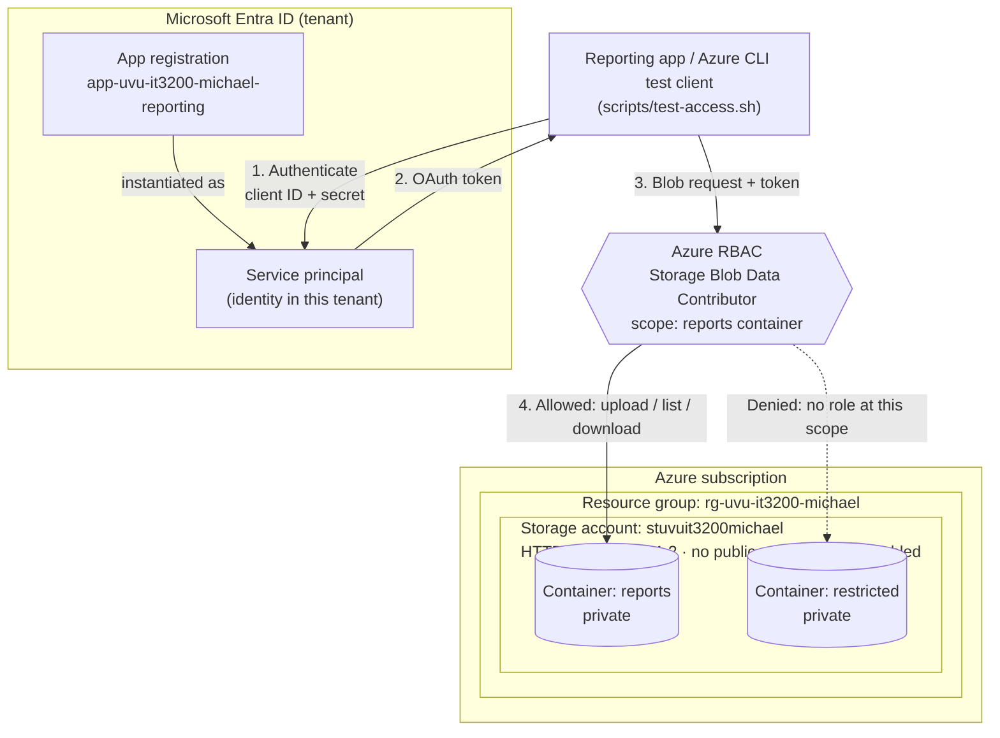

# Least-Privilege Blob Storage Access with a Service Principal (UVU IT 3200)

Terraform deploys Azure Blob Storage and a dedicated **Microsoft Entra ID application identity**
(app registration + service principal) for an automated reporting service. The service principal
gets **one data-plane RBAC role on one container**, so it can upload, list, and download its
reports without a personal account, without storage account keys, and without any management
permissions.

## Architecture



**Authentication vs. authorization:** Entra ID *authenticates* the service principal (proves
who it is) and issues a token. Azure RBAC then *authorizes* each storage request by checking
whether that identity has a role that allows the operation **at that scope**. A valid sign-in alone
grants nothing.

## Resources

| Terraform resource | Name | Purpose |
| ------------------ | ---- | ------- |
| `azurerm_resource_group.this` | `rg-uvu-it3200-michael` | Holds everything for the assignment |
| `azurerm_storage_account.this` | `stuvuit3200michael` | StorageV2 account: HTTPS only, TLS 1.2, no anonymous access, **shared key access disabled**, 7-day soft delete |
| `azurerm_storage_container.app` | `reports` | Private container the app uses |
| `azurerm_storage_container.restricted` | `restricted` | Private container **outside** the app's role scope (negative test) |
| `azuread_application.reporting` | `app-uvu-it3200-michael-reporting` | Application registration (single-tenant) |
| `azuread_service_principal.reporting` | (same display name) | The app's identity in this tenant; receives the role |
| `time_rotating` + `azuread_application_password` | | Short-lived client secret (30 days by default) |
| `azurerm_role_assignment.app_blob_access` | | **Storage Blob Data Contributor** on the `reports` container only |

Naming follows `[resource]-uvu-[course]-[studentname]`. Storage account names cannot contain
hyphens and must be globally unique, 3–24 lowercase letters/numbers, so the account uses
`st` + `uvu` + course + name with no separators (`stuvuit3200michael`). Override it with
`storage_account_name` if that name is taken.

## Identity: application registration vs. service principal

- **Application registration** (`azuread_application`): the app's global *definition*: its name,
  client ID, credentials, and which tenants can use it. Think of it as the blueprint.
- **Service principal** (`azuread_service_principal`): the app's *instance* in a specific tenant.
  It is the security principal that actually signs in and that RBAC roles are assigned to.
  Assigning a role to the app registration is not possible; it must be the service principal.

**Authentication method:** client ID + client secret (OAuth 2.0 client credentials flow), as allowed
by the assignment for a lab. The secret is created by Terraform, valid for 30 days
(`client_secret_rotation_days`), replaced automatically when it expires, marked `sensitive`, and
read by the test script directly into memory. In production, prefer a **managed identity** (when the
app runs in Azure) or **workload identity federation** (e.g. GitHub Actions), which use no stored
secret at all.

Identifiers (not secrets, but redact in screenshots):

```bash
terraform output tenant_id
terraform output client_id                    # application (client) ID
terraform output application_object_id        # app registration object ID
terraform output service_principal_object_id  # service principal object ID
```

## Authorization: role and scope

| Role | Plane | Can read blob contents? | Can upload/modify? | Verdict |
| ---- | ----- | ----------------------- | ------------------ | ------- |
| Reader | Management | **No**: sees the storage account's configuration, but has no blob data actions | No | Doesn't do the job |
| Storage Blob Data Reader | Data | Yes | **No**: read and list only | Can't upload reports |
| **Storage Blob Data Contributor** | Data | Yes | **Yes**: read, write, delete blobs | **Chosen: minimum built-in role that allows upload + download + list** |
| Storage Blob Data Owner | Data | Yes | Yes, plus managing POSIX ACLs / ownership | More than the app needs |
| Owner / Contributor (subscription) | Management | Not via Entra data access by itself, but can grant itself any role or read keys | | Never: far beyond the app's purpose |

**Scope:** the role is assigned on the **`reports` container**, the narrowest scope Azure RBAC
supports for blobs. It does not cover the `restricted` container, the rest of the storage account,
the resource group, or the subscription, and it includes no management-plane permissions (the
service principal cannot read storage keys, change settings, or see other resources).

**Remaining privilege:** Storage Blob Data Contributor also allows deleting blobs in that container.
No built-in role allows upload + download without delete; a production design could use a custom
role with only the read/write/add data actions.

## Prerequisites

- Terraform ≥ 1.6, Azure CLI
- An Azure subscription where you can create resources **and role assignments** (Owner or User
  Access Administrator on the resource group, or higher)
- Permission in Entra ID to register applications. Some student tenants block this; if
  `terraform apply` fails on `azuread_application`, document the exact error and contact the
  professor rather than working around tenant policy.

## Deploy and test (Parts 1–5)

```bash
az login
cp terraform.tfvars.example terraform.tfvars
#   set subscription_id: az account show --query id -o tsv
terraform init
```

**Parts 1–3: infrastructure and identity, with no access yet.**

```bash
terraform apply -var grant_blob_access=false
scripts/test-access.sh
```

Expected: the service principal authenticates successfully, but every blob operation is
**denied** (`AuthorizationPermissionMismatch`), proving that authentication alone grants nothing.
Confirm it has no inherited roles:

```bash
az role assignment list --assignee "$(terraform output -raw service_principal_object_id)" --all -o table
```

**Parts 4–5: grant least-privilege access and verify.**

```bash
terraform apply            # grant_blob_access defaults to true
scripts/test-access.sh     # RBAC can take a few minutes to propagate
```

Expected: upload, list, and download succeed in `reports`; the `restricted` container, reading
storage keys, and listing resource groups stay **denied**.

`scripts/test-access.sh` signs in as the service principal in a **temporary Azure CLI profile**
(`AZURE_CONFIG_DIR`), so your personal `az login` is not replaced, runs the tests, prints a results
table, and signs out. The client secret is never printed or written to disk.

### Optional bonus: break it, fix it

```bash
terraform apply -var grant_blob_access=false   # remove the role
scripts/test-access.sh                         # app operations now denied
terraform apply                                # restore the role
scripts/test-access.sh                         # works again
```

## Clean up

```bash
terraform destroy
```

## Security checklist

- No personal account used by the app; dedicated single-tenant service principal
- No storage keys: `shared_access_key_enabled = false`, so key and account-SAS access is impossible
- No anonymous access; HTTPS only; TLS 1.2 minimum
- Data-plane role only, on one container; no management permissions
- Client secret is short-lived and auto-rotated
- `.gitignore` excludes Terraform state (**which contains the client secret**), `*.tfvars`,
  `.env` files, keys, and test output

## Offline tests

`tests/security.tftest.hcl` runs with mocked providers (no Azure access) and checks the naming,
private/keyless storage settings, that the role is a data-plane role scoped to the app container
and assigned to the service principal, that access can be turned off, and that `Owner` and
long-lived secrets are rejected:

```bash
terraform test
```
